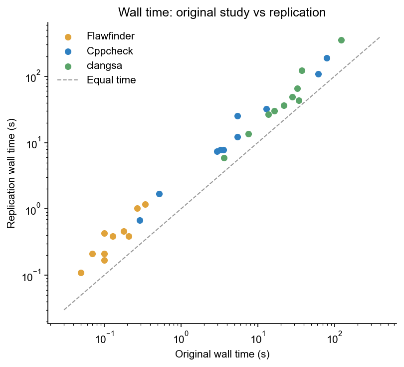
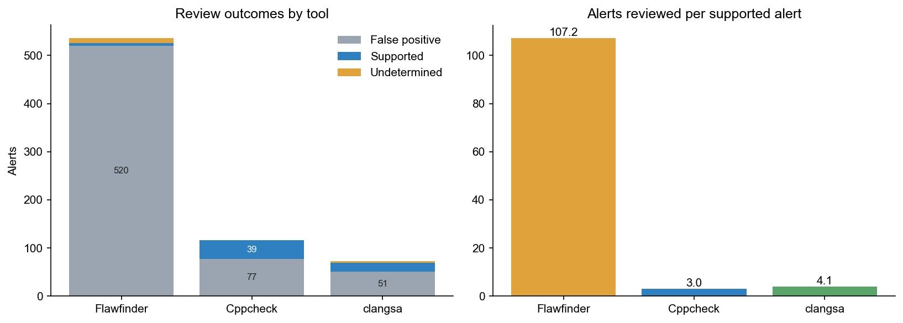
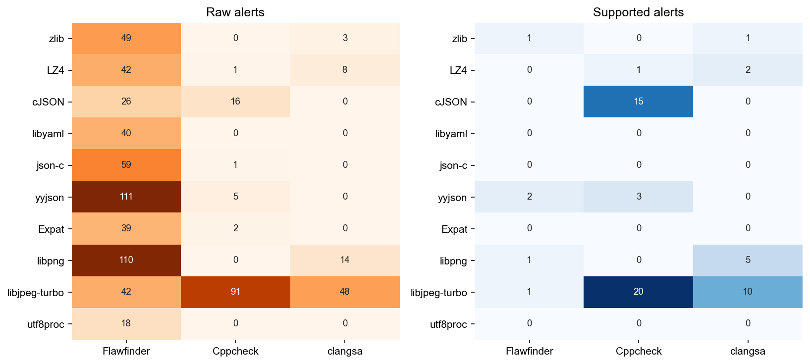
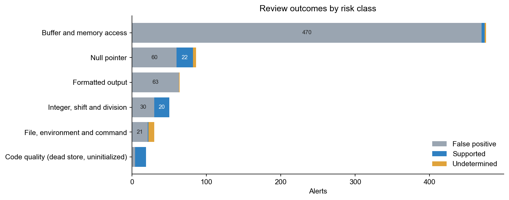
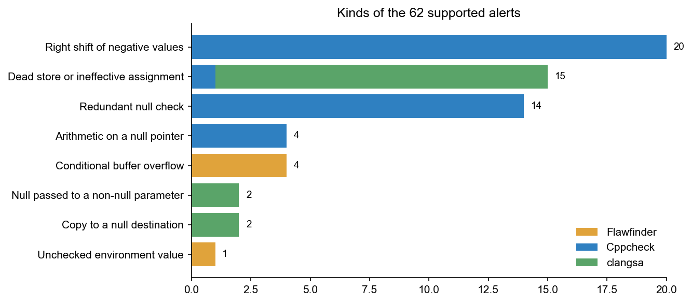
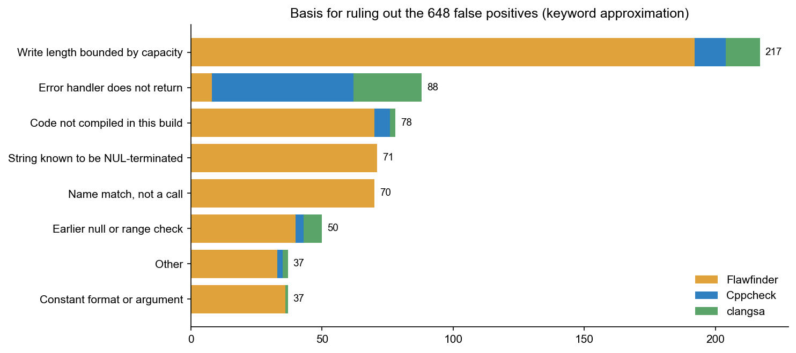

# COMP5355 Project 17：三种静态漏洞检测工具在十个开源 C 库上的比较

我们用 3 个静态漏洞检测工具扫描 10 个开源 C 库，一共 30 次扫描，得到 725 条告警。每条告警都对照源码做了核查，再比较三个工具的告警质量和运行开销。

本目录是**一键复现与结果分析**；原始实验在 `../Project17_Implementation_and_Data/`，只读，不做修改。

| 关键数字 | |
| --- | --- |
| 告警总数 | 725（Flawfinder 536 / Cppcheck 116 / clangsa 73） |
| 核查结论 | 误报 648 / 有依据 62 / 无法判定 15 |
| 复现结果 | 30 组告警全部和原实验一致 |

**目录**：[模块一 三个评估系统](#模块一三个评估系统) · [模块二 数据格式](#模块二数据格式) · [模块三 六步处理流程](#模块三六步处理流程) · [模块四 人工审查机制](#模块四人工审查机制) · [模块五 文件结构与命令](#模块五docker-文件结构与命令逻辑) · [模块六 数据结果分析](#模块六核心数据结果分析) · [结论](#结论三个工具的性能问题与适用场景)

---

## 模块一：三个评估系统

三个工具都是**静态分析**：不运行程序，只读代码找问题。区别在于"读得有多深"。

| | Flawfinder | Cppcheck | CodeChecker + clangsa |
| --- | --- | --- | --- |
| 工作原理 | **查名字**：逐行扫描，看到 `memcpy`、`strcpy`、`strlen` 这类危险函数名就报 | **推算变量的取值**：跟踪变量在赋值和分支里可能取哪些值，再判断有没有问题 | **模拟执行路径**：把输入当成未知数，沿每条分支模拟执行，看某个错误能不能被走到 |
| 打个比方 | 文章里出现"炸弹"两个字就报警 | 读懂句子，判断这个词的用法有没有问题 | 把整个故事推演一遍，看坏结局能不能发生 |
| 是否需要先编译 | 不需要，直接读文本 | 需要编译数据库 | 需要编译数据库，用真实的 Clang 编译器前端 |
| 是否理解宏和条件编译 | 不理解 | 理解，标准库用内置模型 | 完全理解 |
| 擅长 | 快速列出所有用到危险 API 的位置 | 代码质量、可移植性、冗余检查 | 空指针、死存储这类跟路径有关的问题 |
| 短板 | 分不清函数名和变量名，不知道哪段代码根本没编译 | 有些检查需要真实头文件 | 最慢；看不到写在文档里的约定（比如"这个函数永不返回"） |
| 本项目版本 | 2.0.20 | 2.13.0 | 6.29.1，搭配 Clang 18.1.3 |

用同一段代码说明三者的区别。utf8proc 里有一个整数参数恰好叫 `strlen`：

```c
utf8proc_iterate(const uint8_t *str, utf8proc_ssize_t strlen, int32_t *dst) {
  if (!strlen) return 0;                     // 检查长度是否为 0
  end = str + ((strlen < 0) ? 4 : strlen);   // 用长度算读取边界
```

- **Flawfinder**：看到 `strlen` 就报"可能读越界"，在这一个库里就报了 18 条，全部是误报。
- **Cppcheck 和 clangsa**：知道这是一个整数变量，没有报任何告警。

---

## 模块二：数据格式

### 2.1 输入：十个固定版本的库

| 库 | 版本 | 领域 | 编译动作 | Flawfinder 扫描文件 |
| --- | --- | --- | --- | --- |
| zlib | 1.3.2 | 压缩 | 15 | 26 |
| LZ4 | 1.10.0 | 压缩 | 5 | 11 |
| cJSON | 1.7.19 | JSON | 1 | 2 |
| libyaml | 0.2.5 | YAML | 8 | 11 |
| json-c | 0.18 | JSON | 14 | 39 |
| yyjson | 0.12.0 | JSON | 1 | 2 |
| Expat | 2.7.1 | XML | 3 | 19 |
| libpng | 1.6.50 | 图像 | 15 | 22 |
| libjpeg-turbo | 3.1.1 | 图像 | 101 | 88 |
| utf8proc | 2.10.0 | Unicode | 1 | 3 |

- **编译动作**：一个 `.c` 文件在某种配置下的一次编译，Cppcheck 和 clangsa 以它为分析单位。libjpeg-turbo 要按 8/12/16 位三种配置各编译一遍，所以 58 个文件对应 101 个动作。
- **Flawfinder 扫描文件**：直接读取的文本文件，`.c` 和 `.h` 都算。

### 2.2 三个工具的输出

| 工具 | 输出格式 | 一条告警长什么样 |
| --- | --- | --- |
| Flawfinder | 文本 | `gzguts.h:91:15:  [4] (format) vsnprintf:` |
| Cppcheck | XML | `<error id="nullPointerRedundantCheck" ...><location file="..." line="211"/></error>` |
| clangsa | plist 文件（每个编译动作一个） | `{check_name: "core.NullDereference", location: {line: 211, col: 7}}` |

`replication/parsers.py` 把三种格式统一成 **（文件, 行, 列, 规则）**，之后的统计、比对、分析都只用这一种格式。

### 2.3 核查结论数据

原实验的核查总账 `Candidate_Review_Combined.csv` 有 725 行，每行是一条告警，记录了位置、规则、核查结论和理由。结论分三种：

| 结论 | 含义 |
| --- | --- |
| 误报 | 源码证据排除了告警说的那种风险 |
| 有依据 | 源码证据证实告警说的行为确实会发生，或者它的触发条件能满足 |
| 无法判定 | 只看库的代码定不下来，还需要知道调用方或部署环境 |

### 2.4 复现产生的数据

| 位置 | 内容 |
| --- | --- |
| `output/results/` | 每次运行的原始输出：实际命令、工具输出、耗时、退出码 |
| `output/comparison.csv` | 30 行比对表：每一步是否和原实验一致，以及新旧耗时 |
| `output/analysis/` | 模块六的图表和数据表 |
| `output/human_review/` | 模块四的抽样计划和复核表 |

---

## 模块三：六步处理流程

| 步骤 | 做什么 | 为什么要做 | 复现时怎么和原实验比 | 复现结果 |
| --- | --- | --- | --- | --- |
| S1 下载 | 按固定 commit 下载源码 | 保证分析的是同一份代码 | 压缩包哈希一致 | 9/9 一致（cJSON 原实验没有记录哈希） |
| S2 源码准备 | 解包并记录每个文件的哈希 | 确认源码没被改动 | 扫描文件的哈希一致 | 10/10 一致 |
| S3 构建 | 用原来的 CMake 选项编译，导出编译数据库 | Cppcheck 和 clangsa 要靠它知道宏和头文件路径 | 编译数据库逐条一致 | 10/10 一致 |
| S4 工具配置 | 生成三个工具的完整命令 | 参数固定，比较才公平 | 命令逐字节一致 | 30/30 一致 |
| S5 运行计时 | 运行工具，记录耗时和内存 | 得到告警和成本数据 | 每条告警一致 | 30/30 一致，725 条 |
| S6 核查汇总 | 判断每条告警是否成立 | 得出结论 | 告警一致时，原结论直接沿用 | 648 / 62 / 15 |

实验中遇到的特殊情况，复现时都按原样处理：

| 库 | 问题 | 处理 |
| --- | --- | --- |
| yyjson | Cppcheck 第一次运行退出码是 0，但预处理其实失败了 | 加参数 `-D__STDC__=1` 后重跑 |
| libpng | Cppcheck 找不到 `zlib.h` | 先安装 zlib；再给 Cppcheck 单独准备一份编译数据库，把 `-isystem` 改成 `-I` |
| libjpeg-turbo | 136 个编译动作里有 35 个属于命令行工具和示例 | 只分析库本身的 101 个动作 |
| libjpeg-turbo | 生成的头文件里写着构建日期 | 固定日期为原实验的 `20261029` |
| cJSON | 原实验没有构建脚本，也没有计时 | 构建选项按原 `CMakeCache.txt` 还原；成本用 10 月 30 日的补测数据 |

经验：**退出码为 0 不等于跑成功了**。有效运行必须同时满足四个条件：有输入、有记录、正常退出、输出能被解析。

---

## 模块四：人工审查机制

**为什么需要**：原实验 725 条告警的核查都由同一个 AI 助手完成，没有独立的人工复核，也没有做动态验证。这一点在报告 5.2 节列为局限。这个机制的作用是抽出一部分结论交给人工复核，衡量 AI 结论可靠不可靠。

**抽样方案**（`human_review/human_review.py`）：一共 200 条，随机种子固定为 5355，每次运行抽到的结果都一样。

| 类别 | 总数 | 抽多少 | 原因 |
| --- | --- | --- | --- |
| 无法判定 | 15 | 全部 15 条 | 确认缺少的证据是不是真的拿不到 |
| 有依据 | 62 | 全部 62 条 | 这些是最重要的结论 |
| 误报 | 648 | 123 条（约 19%） | 按"工具 × 排除理由"分成 19 层，按比例抽，每层至少 1 条 |

**怎么用**：

```bash
python human_review/human_review.py sample      # 生成 output/human_review/review_sheet.csv
# 复核人对照源码逐条填写两列：
#   reviewer_verdict：Agree（同意）/ Disagree（不同意）/ Unsure（不确定）
#   reviewer_note：理由（选 Disagree 时必填）
python human_review/human_review.py summarize   # 统计一致率，列出所有不同意的条目
```

`summarize` 会输出三类结果：

- 按 AI 结论分组的一致率；
- 误报整体的一致率估计，按每层的大小加权；
- 所有标为 Disagree 或 Unsure 的条目。

复核表里已经有填写内容时，`sample` 会拒绝重新生成，防止把复核结果覆盖掉。

**当前状态**：复核表已经生成，共 200 条，还没有填写，所以目前没有复核结果。

---

## 模块五：Docker 文件结构与命令逻辑

### 5.1 文件结构

```text
Project17_Replication/
├── README.md                     本说明
├── run_replication.sh            一键入口
├── Dockerfile                    Ubuntu 24.04 + 四个工具的固定版本
├── .dockerignore
├── config/
│   └── libraries.json            十个库的统一配置（全部取自原实验记录）
├── replication/                  复现
│   ├── common.py                 由配置生成三个工具的命令
│   ├── pipeline.py               容器内执行 S1–S5
│   ├── parsers.py                把三种输出统一成（文件, 行, 列, 规则）
│   └── compare.py                S6：和原实验逐项比对
├── analysis/
│   └── analyze.py                模块六：分析与画图
├── human_review/
│   └── human_review.py           模块四：抽样与一致率统计
└── output/
    ├── comparison.csv            30 行复现比对表
    ├── results/                  每次运行的原始输出
    ├── analysis/                 figures/ 8 张图，tables/ 9 张表，examples.csv
    └── human_review/             sampling_plan.csv，review_sheet.csv
```

### 5.2 命令

```bash
cd Project17_Replication
bash run_replication.sh             # 全部十个库（首次构建镜像 5–10 分钟，运行约 20–25 分钟）
bash run_replication.sh P01         # 只跑 zlib，用来试跑

# 网络不好时换国内镜像源（工具版本已锁定，不影响结果）
UBUNTU_MIRROR=http://mirrors.ustc.edu.cn/ubuntu bash run_replication.sh

# 下面这些不需要 Docker
python replication/compare.py --self-test   # 先验证比对程序本身是对的
python replication/compare.py               # 比对复现结果
python analysis/analyze.py                  # 生成图表
```

### 5.3 一键运行做了什么

```text
run_replication.sh
 ├─ docker build   安装固定版本的工具，版本不对就直接失败
 ├─ docker run     容器内运行 pipeline.py：每个库依次 S1 下载 → S2 解包 → S3 构建 → S4 生成命令 → S5 运行并计时
 ├─ compare.py     复现结果和原实验逐项比对 → output/comparison.csv
 └─ analyze.py     生成分析图表 → output/analysis/
```

两点设计说明：

- 容器内的工作目录和原实验一样，都是 `/home/yhong/comp5355`。这样 30 条命令、编译数据库，以及告警里的文件路径，都能和原记录逐字比对。这个路径只存在于容器里，和你的电脑放在哪里无关。
- 容器看不到原实验目录。原实验只在比对时被读取，作为参照标准。

---

## 模块六：核心（数据结果分析）

图表由 `python analysis/analyze.py` 生成（图中文字为英文），完整数据在 `output/analysis/tables/`。除本 README 外，项目中的代码注释、程序输出、图表和数据表均为英文。

### 6.1 复现一致性

| 检查 | 结果 |
| --- | --- |
| 源码、编译数据库、命令、告警 | 全部一致（S1–S5） |
| 内存 | 和原实验相差不到 1.4% |
| 耗时 | 是原实验的 1.3–4.7 倍，因为机器更慢，又跑在 Docker 里；三个工具的快慢顺序不变 |



### 6.2 按工具



| 工具 | 告警 | 误报 | 有依据 | 无法判定 | 有依据比例 | 找到 1 条有依据，平均要看几条 |
| --- | --- | --- | --- | --- | --- | --- |
| Flawfinder | 536 | 520 | 5 | 11 | 0.9% | 107 条 |
| Cppcheck | 116 | 77 | 39 | 0 | 33.6% | 3 条 |
| clangsa | 73 | 51 | 18 | 4 | 24.7% | 4 条 |

### 6.3 按库



| 现象 | 说明 |
| --- | --- |
| Flawfinder 在十个库上都有告警 | 它不需要编译；yyjson（111 条）、libpng（110 条）最多 |
| 另外两个工具的告警集中在 libjpeg-turbo | Cppcheck 116 条中有 91 条，clangsa 73 条中有 48 条 |
| 有依据的告警集中在 2 个库 | libjpeg-turbo 31 条，cJSON 15 条 |
| 4 个库没有任何有依据的告警 | libyaml、json-c、Expat、utf8proc |
| 只有 Flawfinder 在头文件上报告警 | 一共 94 条落在 `.h` 里，其中 93 条是误报；另外两个工具在预处理之后分析，告警都落在 `.c` 里 |

### 6.4 按风险类型



| 风险类型 | 告警 | 有依据 | 典型情况 |
| --- | --- | --- | --- |
| 缓冲区与内存访问 | 476 | 4 | 数量最多，几乎都是 Flawfinder 看到 `memcpy`、`strlen` 就报 |
| 空指针 | 86 | 22 | 60 条误报里有 48 条被"错误处理函数不返回"排除；有依据的主要是冗余判空 |
| 格式化输出 | 64 | 0 | 将近一半的误报（29/63）位于没有被编译的调试代码里 |
| 整数、移位与除零 | 50 | 20 | 20 条负数右移全部有依据 |
| 文件、环境与外部命令 | 30 | 1 | 无法判定最多（8 条），因为需要知道部署环境 |
| 代码质量（死存储等） | 19 | 15 | 有依据比例最高 |

### 6.5 有依据的 62 条是什么问题



| 问题 | 条数 | 工具 | 例子 |
| --- | --- | --- | --- |
| 负数右移的可移植性 | 20 | Cppcheck | libjpeg-turbo：对可能为负的数右移，结果随编译器不同 |
| 死存储与无效赋值 | 15 | clangsa / Cppcheck | libjpeg-turbo：赋值后马上被覆盖，从没被读过 |
| 冗余的判空检查 | 14 | Cppcheck | cJSON：调用前已经判过空，这里又判一次 |
| 对空指针做指针运算 | 4 | Cppcheck | yyjson：先算 `alc + 1`，后检查 `alc` 是否为空 |
| 条件性缓冲区溢出 | 4 | Flawfinder | zlib、libpng：特定状态下写越界（见 6.8 案例三、四） |
| 给 `memcpy` 传了空指针 | 2 | clangsa | libpng：长度为 0 时把 NULL 当作源地址 |
| 特定参数下复制到空目标 | 2 | clangsa | LZ4（见 6.8 案例六） |
| 环境变量数值没检查上限 | 1 | Flawfinder | libjpeg-turbo：`JPEGMEM` 的值过大时乘法会溢出 |

62 条里有 49 条（前三类）是代码质量或可移植性问题，真正接近安全漏洞的只有少数几条。

### 6.6 无法判定的 15 条缺什么

| 缺少的信息 | 条数 | 例子 |
| --- | --- | --- |
| 调用方和部署环境 | 9 | zlib `gzprintf` 的格式串由调用方传入，库内无法知道它是否可信 |
| 能否走到问题代码 | 4 | LZ4：接口文档和代码实现不一致，没能证明这条路径能走到 |
| 极端边界的行为 | 2 | libyaml：长度等于 `INT_MAX` 时 `length+1` 会溢出，后续行为无法确定 |

### 6.7 误报是怎么被排除的



这里是按核查理由里的关键词近似归类的，只用来帮助阅读。

| 排除理由 | 条数 | 例子 |
| --- | --- | --- |
| 写入量不超过容量 | 217 | cJSON `strcpy`：只有新字符串不比旧的长时才复用旧内存（案例二） |
| 错误处理函数不返回 | 88 | libjpeg-turbo：出错时程序直接退出，后面的空指针用不到（案例五） |
| 代码没有被编译 | 78 | libpng：调试宏没开启，那行 `fprintf` 实际不存在 |
| 字符串一定以 `\0` 结尾 | 71 | libyaml：读取的是专门复制出来、保证有结尾符的字符串 |
| 名字匹配错了 | 70 | utf8proc：`strlen` 是变量名（案例一） |
| 前面已经检查过 | 50 | zlib：size 为 0 时根本不会走到除法 |
| 参数是固定的 | 37 | libyaml：格式串是写死的 `"id%03d"` |
| 其他 | 37 | yyjson：参数 `u8 *con[2]` 实际是指针，不是数组 |

### 6.8 特别案例详解

#### 案例一：变量名叫 `strlen`，Flawfinder 报了 18 次（误报，名字匹配错误）

utf8proc 的 `utf8proc.c:126`：

```c
utf8proc_iterate(const uint8_t *str, utf8proc_ssize_t strlen, int32_t *dst) {
  if (!strlen) return 0;
  end = str + ((strlen < 0) ? 4 : strlen);
```

- **告警**：Flawfinder 认为这里调用了 `strlen()`，可能读到字符串结尾之外。
- **实际**：这里的 `strlen` 是一个整数参数，代码只是检查它是否为 0，再用它算读取边界，根本没有调用 `strlen()` 函数。
- **说明**：Flawfinder 只认名字、不懂语法。另外两个工具在这个库上一条告警都没有。

#### 案例二：cJSON 的 `strcpy` 看起来危险，其实安全（误报，容量分析）

`cJSON.c:449–456`：

```c
v1_len = strlen(valuestring);           // 新字符串长度 M
v2_len = strlen(object->valuestring);   // 旧字符串长度 N
if (v1_len <= v2_len) {                 // 只有新的不比旧的长时
    ...
    strcpy(object->valuestring, valuestring);   // 才复用旧内存
}
// 否则走下面的分支，重新分配一块足够大的内存
```

- **告警**：`strcpy` 不检查目标大小，可能溢出。
- **推理**：旧字符串分配时至少有 N+1 字节；只有 M ≤ N 时才执行 `strcpy`，写入 M+1 字节。所以写入量 M+1 ≤ N+1 ≤ 容量，不会溢出。
- **说明**：判断 `strcpy` 是否危险要看上下文的长度关系，只看函数名得不出结论。

#### 案例三：zlib 的 `memcpy` 真的可能越界（有依据）

`gzwrite.c:212–217`：

```c
have = (unsigned)((state->strm.next_in + state->strm.avail_in) - state->in);
copy = state->size - have;       // 剩余空间
if (copy > len) copy = len;
memcpy(state->in + have, buf, copy);
```

- **前提**：代码默认 `have ≤ size`。
- **问题**：在非阻塞写模式下，`gzprintf` 可以合法地留下 `have > size` 的状态（缓冲区一共有 2×size 字节）。这时 `size - have` 是无符号减法，会下溢成一个很大的数，`copy` 就等于整个 `len`，写入超出缓冲区。
- **触发条件**：要按"缓冲区设得很小 → 非阻塞管道写满 → `gzprintf` → 再 `gzwrite`"这个顺序操作。
- **说明**：这是 Flawfinder 536 条告警里少数真实成立的一条，但要在很特殊的状态下才能触发。

#### 案例四：注释写着"安全"，libpng 实际可能写越界（有依据）

`pngrutil.c:3939–3942`：

```c
png_byte v[8]; /* SAFE; pixel_depth does not exceed 64 */
memcpy(v, sp, pixel_bytes);
```

- **注释的假设**：一个像素最多 64 位，也就是 8 字节，所以 `v[8]` 够用。
- **实际**：应用可以注册自定义的读取变换，把输出声明成 3 通道 × 32 位 = 96 位，也就是 12 字节，libpng 会接受这个设置。如果图像还是隔行扫描（Adam7），展开时就会把 12 字节写进 8 字节的数组。
- **说明**：代码作者的假设在某些配置下不成立。触发需要应用主动做这种配置，不是普通用户输入就能触发的。

#### 案例五：同一行被两个工具报空指针，都被"出错就退出"排除（误报）

libjpeg-turbo 的 `jdapistd.c:207–211`：

```c
if (!xoffset || !width)
    ERREXIT(cinfo, JERR_BAD_CROP_SPEC);   // width 为空时报错
if (*width == 0 || ...)                    // 告警：这里可能解引用空指针
```

`ERREXIT` 最终调用 `error_exit`，默认实现是：

```c
error_exit(j_common_ptr cinfo) {
  (*cinfo->err->output_message) (cinfo);
  jpeg_destroy(cinfo);
  exit(EXIT_FAILURE);                       // 直接结束程序
}
```

- **告警**：Cppcheck 和 clangsa 都认为 `width` 为空时程序会继续执行到下一行。
- **实际**：`width` 为空时程序已经退出了。接口文档也规定，自定义的 `error_exit` 也不能返回。
- **说明**：这条约定只写在文档里，函数声明上没有标 `noreturn`，所以两个工具都看不到。约 88 条误报都是这个原因，是两个语义分析工具共同的盲区。

#### 案例六：LZ4 的 `assert` 在发布版里不起作用（有依据）

`lz4hc.c:1751–1753`：

```c
if (safeBuffer == NULL) assert(dictSize == 0);   // 只在调试版里检查
if (dictSize > 0)
    LZ4_memmove(safeBuffer, streamPtr->end - dictSize, (size_t)dictSize);
```

- **问题**：作者用 `assert` 表达"缓冲区为空时字典长度必须为 0"。但本次构建没有开启 `LZ4_DEBUG`，`assert` 是空操作。调用方如果传入 `safeBuffer=NULL` 且 `dictSize>0`，就会往空地址复制数据。
- **定性**：需要调用方传入不合法的参数组合，属于接口没有做防御。
- **对比**：同一个库里另外 4 条类似告警被判为"无法判定"，因为没能证明正常调用能走到那里。

---

## 结论：三个工具的性能、问题与适用场景

### 三个工具的综合对比

| | Flawfinder | Cppcheck | clangsa |
| --- | --- | --- | --- |
| **速度**（单次 / 10 个库合计） | 最快：0.05–0.34 秒 / 1.55 秒 | 中等：0.29–79 秒 / 176 秒 | 最慢：3.7–122 秒 / 318 秒 |
| **内存**（最大常驻） | 约 20–25 MiB | 18–332 MiB，随库差别很大 | 176–214 MiB，比较稳定 |
| **告警量** | 最多（536） | 中等（116） | 最少（73） |
| **准确度** | 最低：有依据只占 0.9% | 最高：33.6% | 较高：24.7% |
| **人工审查负担** | 最重：平均 107 条才有 1 条有依据 | 最轻：平均 3 条 | 较轻：平均 4 条 |
| **能发现什么** | 少数特定状态下的缓冲区溢出（zlib、libpng） | 可移植性问题、冗余检查、空指针运算 | 死存储、空指针参数 |
| **主要问题** | 只认名字：把变量名当函数，报没被编译的代码，算不了容量 | 看不到"出错就退出"的约定；告警集中在少数库 | 和 Cppcheck 一样看不到这条约定；最慢 |
| **适合场景** | 第一遍粗筛，列出危险 API 的使用位置 | 日常开发中的代码质量检查 | 需要判断路径能否走到时做深入检查 |

### 主要结论

1. **告警多不等于找到的问题多。** Flawfinder 告警最多、跑得最快，但几乎全是误报，人工审查成本最高。按"每找到一条有依据要看多少条告警"计算，Cppcheck 的效率是 Flawfinder 的 35 倍以上。
2. **三个工具几乎互不覆盖。** 725 条告警分布在 680 个位置，只有 11 个位置被多个工具同时报告，而且没有一处是多个工具都有依据的同一个问题。所以三个工具是互补关系，不能互相替代。
3. **有依据的问题大多是代码质量问题。** 62 条里有 49 条是负数右移、死存储、冗余判空；真正接近安全漏洞的只有少数几条，而且都要在特殊状态或特殊参数下才能触发，比如 zlib 和 libpng 的越界写、LZ4 的空指针复制。
4. **语义分析工具有共同的盲区。** Cppcheck 和 clangsa 都看不到写在文档里的约定，比如"错误处理函数不返回"，由此产生了 88 条误报。只要在代码里标注 `noreturn`，就能消除这一类误报。
5. **耗时和内存给出的排名可能相反。** 例如 libpng 上 Cppcheck 更慢，但内存只用了 clangsa 的三分之一。评价工具成本时，两个指标都要看。
6. **建议的组合用法**：日常用 Cppcheck；对关键模块用 clangsa 深入检查；Flawfinder 只用来列出危险 API，而且要配合抑制规则，否则噪声太大。

### 结论的适用范围

- **没有标准答案**：我们比较的是"报了什么、有多少成立"，不知道每个工具漏掉了什么。所以不能说 Cppcheck "发现的问题最多"。
- **库的选择有偏差**：10 个库里有 5 个是解析器，这类代码里 `memcpy`、`strlen` 特别多，会抬高 Flawfinder 的告警量。
- **核查都由 AI 完成**：725 条结论没有经过独立的人工复核，模块四提供了复核的方法，但还没有执行。
- **成本只测了一次**：复现显示，换一台机器耗时会差 1.3–4.7 倍，所以耗时只能看相对快慢，不能看绝对数字。
